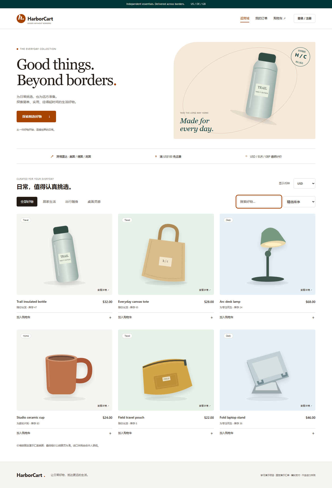
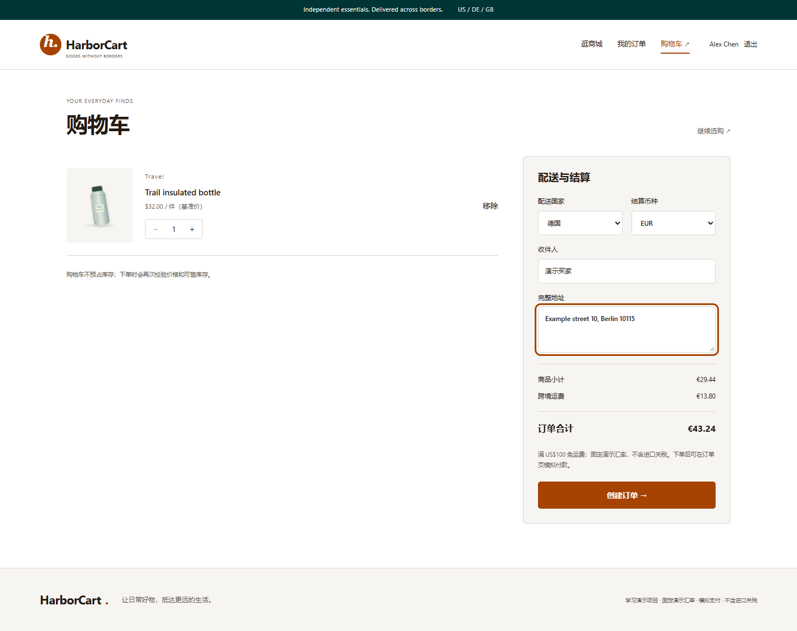

# HarborCart 跨境生活用品商城

可本地运行的 Java 全栈学习项目：Vue 3 + Vue Router + Vite / Spring Boot 3.5 + Spring MVC + Spring JDBC / MySQL 8.4 / Redis。

## 已实现

- 买家：注册、登录、分类与搜索、排序、商品详情、购物车增减、跨境运费报价、下单、订单列表、模拟付款、取消待付款订单。
- 运营：管理员权限隔离、真实订单统计、按币种分别统计销售额、商品新增与编辑、库存维护、上下架、填写物流单号发货。
- 跨境规则：US / DE / GB 配送；USD / EUR / GBP 计价；USD 基准价格满 100 免运费；否则美国 12、德国 15、英国 14 美元。固定汇率 USD=1、EUR=0.92、GBP=0.79，逐商品单价换算到分后汇总。**非实时汇率，不含进口税费**。
- 一致性：MySQL 事务、商品行锁、条件扣减、订单金额与商品名称快照、按用户和请求键保证下单幂等；取消仅回补一次库存。
- 安全：BCrypt 密码哈希、随机 Bearer 令牌、数据库仅保存令牌 SHA-256 摘要、8 小时有效期、退出撤销、接口权限和参数校验。前端令牌仅保存在内存，刷新后需重新登录。
- 缓存：Redis 商品目录缓存，TTL 60 秒；商品、库存写操作提交后删除缓存。Redis 故障时降级查 MySQL，30 秒后重试；结算始终从 MySQL 加锁读取。

## 推荐启动方式

需要 Java 17+、Maven 3.6.3+、Node 22.12+、Docker Desktop（已启动）。开发验证使用 Java 25 与 Node 22。

在项目根目录启动数据库和 Redis：

```powershell
docker compose up -d
```

启动后端（第二个终端）：

```powershell
cd backend
mvn spring-boot:run
```

启动前端（第三个终端）：

```powershell
cd frontend
npm ci
npm run dev
```

访问 http://127.0.0.1:5173 。前端将 `/api` 代理到本机 8080，避免开发环境跨域配置。若端口冲突，先释放端口或同步修改配置。

仓库使用上述 Docker 与 Maven 启动方式。本次开发工作区额外提供的 `start-local.ps1` 依赖本机路径，仅保留在本地，不随仓库上传。

## 页面预览





## 演示账户

| 角色 | 邮箱 | 密码 |
| --- | --- | --- |
| 买家 | buyer@harborcart.demo | BuyerDemo123! |
| 管理员 | admin@harborcart.demo | AdminDemo123! |

只在 `DEMO_ENABLED=true` 时创建演示账户和样例商品，并允许模拟付款。数据仅首次插入，重启不重置订单和库存。

## 验证

```powershell
cd backend
mvn test
mvn package
cd ../frontend
npm run build
```

后端测试使用 H2 MySQL 模式，不依赖本机 MySQL 或 Redis。覆盖服务端计价、免运费、下单幂等、库存不足回滚、库存争抢、订单越权、状态流转、令牌撤销、接口权限及非法数量。MySQL 联调脚本见 `scripts/smoke.mjs`（Node 原生 fetch，无额外依赖）。

```powershell
node scripts/smoke.mjs
```

该脚本会创建唯一测试账户与商品并保留测试订单；仅在本地演示数据库运行。无生产性能结论。

## 配置

| 环境变量 | 默认值 | 用途 |
| --- | --- | --- |
| DB_URL | jdbc:mysql://127.0.0.1:3308/harborcart?useSSL=false&allowPublicKeyRetrieval=true&serverTimezone=UTC&characterEncoding=UTF-8 | MySQL 连接 |
| DB_USER | harborcart | 数据库用户 |
| DB_PASSWORD | harborcart_local_2026 | 本地演示密码 |
| REDIS_HOST / REDIS_PORT | 127.0.0.1 / 6380 | Redis |
| CACHE_ENABLED | true | 目录缓存开关 |
| DEMO_ENABLED | true | 演示账户、样例数据、模拟付款 |
| PORT | 8080 | 后端端口 |

默认密码只适用于本地演示。对外部署需设置自己的凭据、HTTPS、反向代理限流和运维监控，并关闭演示模式；已经创建的演示账户需另行停用。前端 `npm run build` 输出 `frontend/dist`，部署时将 `/api` 代理至后端。SQL 初始化使用 `CREATE TABLE IF NOT EXISTS`；后续生产迭代应使用版本化数据库迁移。

## 项目结构

```text
backend/src/main/java/com/harborcart/
  AuthService.java     # 密码、令牌与用户
  AuthFilter.java      # API 登录检查
  ShopController.java  # REST 路由与角色检查
  ShopService.java     # 购物车、计价、订单事务、运营
  CatalogCache.java    # Redis 缓存与降级
backend/src/main/resources/schema.sql
backend/src/test/      # 业务和接口测试
frontend/src/pages/   # 商城、登录、购物车、订单、后台
frontend/public/images/ # 自带 SVG 商品插画，无第三方图片依赖
docs/                 # 架构、面试讲解、验证记录
```

## 范围与局限

这是个人学习演示项目，不是已上线商业平台。没有真实收款、物流订阅、税务清关或商家入驻功能；没有压测数据。待付款订单由用户手动取消，尚无自动超时关单。目录库存可能在缓存 TTL 内陈旧，结算以数据库校验为准；并发回填可能短暂复活旧缓存，TTL 收敛。订单列表最多显示最近 200 条，较大数据量时应加游标分页。后台库存编辑是绝对数量，正式多人运营应增加版本校验和库存流水审计。未接入邮箱验证及密码找回。

技术参考：[Spring Boot 系统要求](https://docs.spring.io/spring-boot/3.5/system-requirements.html)、[Vue 快速上手](https://vuejs.org/guide/quick-start.html)。
