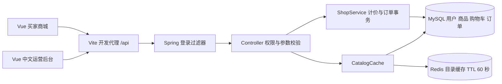

# 架构与接口

## 关系模型

users 1:N auth_tokens；users 1:N cart_items；products 1:N cart_items；users 1:N shop_orders；shop_orders 1:N order_items；products 1:N order_items。订单明细保存名称、单价和数量快照。商品使用上下架而非删除，以保留历史引用。

唯一键：users.email、cart_items(user_id,product_id)、shop_orders(user_id,request_key)、auth_tokens.token_hash。主外键由数据库约束。所有用户输入值经 JDBC 占位参数传入 SQL。

## REST 路由

除公开目录、配置、注册和登录外，均需 `Authorization: Bearer <token>`。

| 方法 | 路径（均以 /api 开头） | 权限与用途 |
| --- | --- | --- |
| GET | /config | 公开：演示开关、汇率、国家 |
| GET | /products | 公开：在售商品目录 |
| POST | /auth/register | 注册买家 `{email,password,name}` |
| POST | /auth/login | 登录 `{email,password}`，返回 token 与 user |
| GET | /auth/me | 当前用户 |
| POST | /auth/logout | 撤销当前令牌 |
| GET | /cart | 当前用户购物车 |
| PUT | /cart/{productId} | `{quantity}`；0 为删除，最大 99 |
| GET | /quote?currency=EUR&country=DE | 服务端报价 |
| POST | /orders | `{requestKey,currency,country,recipient,address}`；返回订单及明细 |
| GET | /orders | 当前用户最近 200 条订单 |
| POST | /orders/{id}/pay | 演示模式模拟付款 |
| POST | /orders/{id}/cancel | 取消自己的待付款订单 |
| GET | /admin/dashboard | 管理员真实汇总数据 |
| GET / POST | /admin/products | 管理员商品列表 / 新增 |
| PUT | /admin/products/{id} | 管理员编辑和上下架 |
| GET | /admin/orders | 管理员最近 200 条订单 |
| POST | /admin/orders/{id}/ship | 管理员发货 `{tracking}` |

商品写入字段：name、category（Home/Travel/Desk）、description、price（USD）、stock、image（六个内置图片路径之一）、active。错误响应格式 `{ "message": "可读提示" }`；401 未登录、403 无权限、404 资源不存在、409 库存或状态冲突、400 参数非法。
